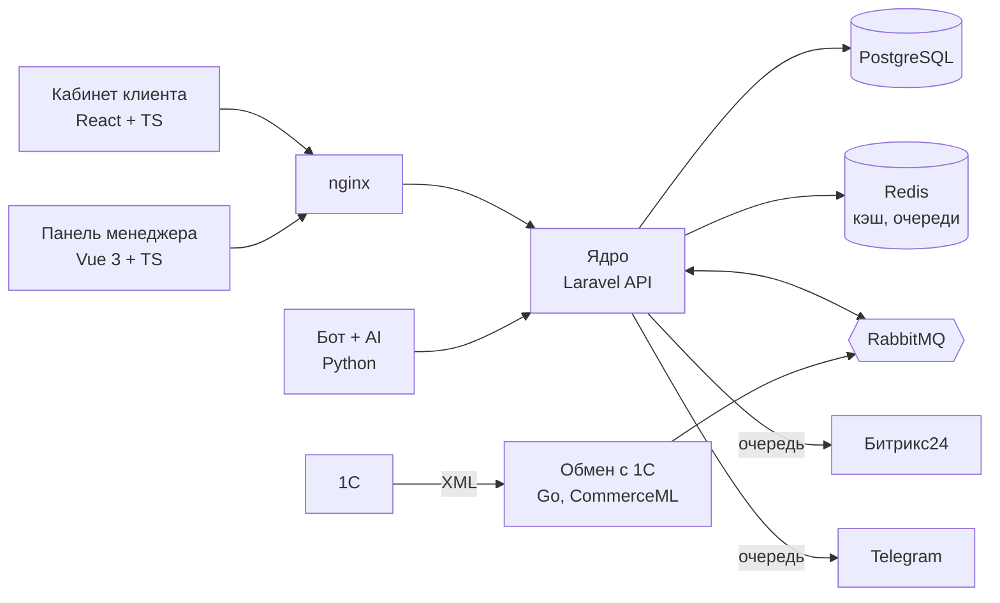

# B2B-портал оптовика

Демо-проект: оптовые клиенты сами заказывают товар по ценам своих договоров, менеджеры ведут заказы и клиентов, каталог, цены и остатки приходят из 1С, сделки уходят в Битрикс24.

Данные в демо выдуманные (оптовик электротоваров).

## Архитектура



| Сервис | Папка | Стек |
|---|---|---|
| Ядро: каталог, компании, цены по договорам, корзина, заказы, роли, REST API | `core-laravel` | PHP 8.4, Laravel 13, Sanctum |
| Кабинет клиента | `client-react` | React, TypeScript, Vite |
| Панель менеджера | `manager-vue` | Vue 3, TypeScript, Vite |
| Обмен с 1С | `exchange-go` | Go |
| Telegram-бот и AI | `bot-python` | Python |
| Инфраструктура | `infra` | Docker, nginx |

## Что уже работает

- Цена по договору клиента: индивидуальная цена договора, иначе вид цен договора (розница, опт, крупный опт) со скидкой договора. Расчёт в `PriceResolver`, деньги через bcmath.
- Каталог: дерево категорий, поиск по названию и артикулу, фасетные фильтры по бренду и характеристикам (JSONB), остатки по складам.
- Корзина, минимальная партия, проверка кредитного лимита компании при оформлении.
- Заказ из Excel или CSV (колонки «Артикул» и «Количество»), шаблон для скачивания.
- Повтор заказа, история статусов.
- Роли: закупщик видит свои заказы, руководитель клиента все заказы компании, сотрудники оптовика не пользуются клиентской корзиной.
- После заказа в очереди: PDF-счёт (НДС 16%) и письмо менеджеру со счётом во вложении (в демо приходит в Mailpit).
- OpenAPI-документация: http://127.0.0.1:8201/docs/api

## Демо-доступ

Пароль у всех `demo12345`.

| Кто | Email |
|---|---|
| Закупщик клиента (крупный опт, индивидуальные цены) | buyer@energomontazh.demo |
| Руководитель клиента | director@energomontazh.demo |
| Закупщик клиента (розница со скидкой, предоплата) | buyer@domstroy.demo |
| Менеджер оптовика | manager@demo.kz |
| Администратор | admin@demo.kz |

## Запуск

Нужны Docker и make.

```bash
cp core-laravel/.env.docker.example core-laravel/.env
make up
docker compose exec core php artisan key:generate
make fresh
```

| Адрес | Что |
|---|---|
| http://127.0.0.1:8201 | кабинет клиента |
| http://127.0.0.1:8201/manager/ | панель менеджера |
| http://127.0.0.1:8201/api/health | состояние ядра |
| http://127.0.0.1:8205 | RabbitMQ (b2b / b2b) |
| http://127.0.0.1:8206 | Mailpit |

Обмен с 1С: `make w2` (порт 8207).

## Команды

| | |
|---|---|
| `make up` / `make down` | поднять / остановить |
| `make fresh` | пересоздать БД с демо-данными |
| `make test` | тесты ядра |
| `make pint` | форматирование PHP |
| `make sh` | shell в контейнере ядра |
