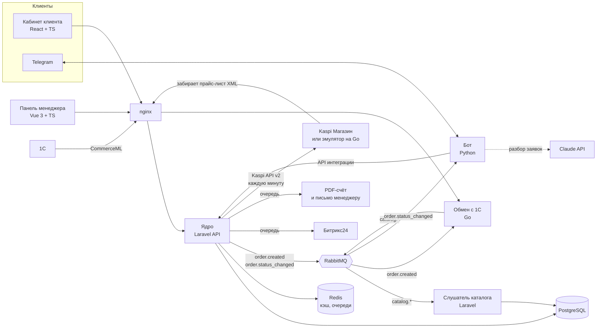
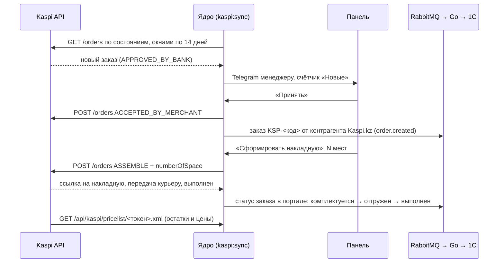

# B2B-портал оптовика

Оптовые клиенты сами заказывают товар по ценам своих договоров, менеджеры ведут заказы, клиентов и цены, каталог с ценами и остатками приходит из 1С, заказы уходят обратно в 1С и в Битрикс24, заявки можно присылать в Telegram текстом или фото.

Плюс модуль **Kaspi Магазин**: заказы с Kaspi.kz принимаются, собираются и выдаются из панели, уходят в 1С тем же обменом, остатки и цены уезжают в Kaspi прайс-листом. Работает и без 1С: тогда остатки ведутся прямо в панели. Подробности в разделе [Kaspi Магазин](#kaspi-магазин).

**Посмотреть онлайн:** [кабинет клиента](https://nitro.tailf772e4.ts.net/b2b/) · [панель менеджера](https://nitro.tailf772e4.ts.net/b2b/manager/) · [API](https://nitro.tailf772e4.ts.net/b2b/docs/api). Вход прямо на странице, пароль `portal2026`, данные сбрасываются каждую ночь.

Все компании, товары, бренды и реквизиты выдуманы.

## Архитектура



| Сервис | Папка | Стек | Что делает |
|---|---|---|---|
| Ядро | `core-laravel` | PHP 8.4, Laravel 13, Sanctum, Scramble | каталог, компании и сотрудники, цены по договорам, корзина, заказы, роли, REST API, очереди |
| Кабинет клиента | `client-react` | React 19, TypeScript, TanStack Query, Tailwind | каталог с фильтрами, корзина, заказ из Excel, история, повтор, счета |
| Панель менеджера | `manager-vue` | Vue 3, TypeScript, Pinia, Chart.js, Tailwind | сводка с графиками, заказы и статусы, клиенты, условия и цены, журнал обмена с 1С |
| Обмен с 1С | `exchange-go` | Go, RabbitMQ | протокол обмена 1С с сайтом, потоковый разбор CommerceML, заказы для 1С |
| Эмулятор Kaspi | `kaspi-emu` | Go, только стандартная библиотека | Kaspi Shop API v2 по документации: заказы, статусы, накладные, код выдачи, прайс-лист |
| Бот | `bot-python` | Python, aiogram, aio-pika, Anthropic SDK | заявка текстом или фото в корзину, статусы заказов |
| Инфраструктура | `infra` | Docker, nginx | шлюз, продакшн-сборка, генератор и эмулятор выгрузок 1С |

## Что умеет

**Клиент**
- Видит цены своего договора: индивидуальная цена договора, иначе вид цен договора (розница, опт, крупный опт) со скидкой договора. Расчёт в `PriceResolver`, деньги через bcmath.
- Каталог: дерево категорий, поиск по названию и артикулу, фасетные фильтры по бренду и характеристикам (JSONB), остатки по складам.
- Корзина с минимальной партией, проверка кредитного лимита при оформлении.
- Заказ из Excel или CSV (колонки «Артикул» и «Количество»), шаблон для скачивания.
- Повтор заказа, история статусов, PDF-счёт с НДС 16%.
- Роли: закупщик видит свои заказы, руководитель клиента все заказы компании.

**Менеджер**
- Сводка за 7, 30, 90 дней или год: выручка, средний чек, выручка по дням, статусы, топ товаров и клиентов. Фильтр «только мои клиенты».
- Заказы: фильтры, смена статуса по разрешённым переходам с комментарием, история.
- Клиенты: условия договора, кредитный лимит и его загрузка, индивидуальные цены с отклонением от договорной, сотрудники клиента (создание доступа, блокировка).
- Журнал обмена с 1С: размер файла, время разбора в Go, сколько применено в портале.

**Интеграции**
- **1С.** Стандартный обмен с сайтом (`checkauth` → `init` → `file` → `import`, CommerceML 2.05 и 2.08, UTF-8 и windows-1251). Go разбирает XML потоково, память не растёт с размером файла: 20 000 товаров (12,5 МБ) и 40 000 цен (10 МБ) разбираются за 0,7 с каждый. Пачки по 500 уходят в RabbitMQ с подтверждением доставки, Laravel применяет их идемпотентно, сбойные сообщения уходят в `core.catalog.dead`. Заказы портала 1С забирает в режиме `sale&mode=query`; сообщение в очереди подтверждается только после `mode=success`, поэтому заказ не теряется, если 1С оборвала обмен.
- **Битрикс24.** По новому заказу создаётся компания (если её нет) и сделка с товарными строками, смена статуса двигает стадию сделки. Включается вебхуком `B24_WEBHOOK_URL`.
- **Telegram.** Клиент привязывает Telegram одноразовой ссылкой из кабинета и присылает заявку текстом или фото: бот разбирает её, подбирает товары по ценам договора с учётом минимальной партии и кладёт в корзину, а непонятные строки просит уточнить. Статусы заказов приходят из RabbitMQ. Менеджер получает новые заказы своих клиентов.
- **ИИ.** Заявки разбирает Claude (`claude-opus-5-5`, строгая JSON-схема, понимает фото рукописных списков), при отказе модели запрос переходит на резервную модель (server-side fallback). Без ключа Anthropic работает разбор текста по правилам.
- **Почта.** Менеджер получает письмо о новом заказе со счётом во вложении. Локально письма ловит Mailpit.

## Kaspi Магазин

Модуль для продавца на Kaspi.kz поверх того же ядра. Раздел «Kaspi Магазин» в панели менеджера: заказы, продажи, товары, настройки.

**Как устроено**



- **Заказы.** Планировщик раз в минуту опрашивает `GET /shop/api/v2/orders` по каждому состоянию (NEW, SIGN_REQUIRED, PICKUP, DELIVERY, KASPI_DELIVERY, ARCHIVE) окнами по `creationDate`, пишет только изменившиеся заказы. Позиции сопоставляются с каталогом по артикулу продавца: позиция → `masterproducts` → `merchantProduct.code`, связь кэшируется. Первый запуск загружает историю молча: без уведомлений и без отправки старых заказов в 1С.
- **Действия.** Принять, отменить с причиной Kaspi, сформировать накладную Kaspi Доставки и скачать PDF, выдать самовывоз или свою доставку по коду из приложения покупателя (`X-Send-Code`, `X-Security-Code`). После каждого действия заказ перечитывается из Kaspi, всё пишется в журнал заказа.
- **1С.** Принятый заказ становится заказом портала `KSP-<код>` от контрагента «Kaspi.kz» и уходит в 1С существующим обменом CommerceML. Статусы Kaspi двигают статус этого заказа, вручную в разделе «Заказы» его менять нельзя. Если товара нет в каталоге, заказ помечается и в 1С не уходит.
- **Без 1С.** Переключатель в настройках. Остатки правятся в таблице товаров или файлом Excel (Артикул, Цена, Остаток), принятый заказ списывает остаток, отмена и возврат на склад возвращают его.
- **Прайс-лист.** `GET /api/kaspi/pricelist/<токен>.xml` в формате кабинета Kaspi (`kaspi_catalog`, `availabilities` по складам Kaspi, `price`). Остатки берутся со склада портала, привязанного к storeId Kaspi, цена из типа цен 1С или своя.
- **Сводка.** Выручка по дням, средний чек, доля отмен, расходы на Kaspi Доставку, способы доставки, топ товаров, выставленные товары без остатка.
- **Автоприём** (выключен по умолчанию): заказ принимается сам, если все товары сопоставлены и есть на складе.
- **Telegram:** выбранному сотруднику приходит новый заказ Kaspi со ссылкой «Принять в панели».

**Эмулятор.** Настоящего токена здесь нет, поэтому `kaspi-emu` (Go, только стандартная библиотека) отвечает теми же путями, полями и статусами, что описаны в [справочнике Kaspi](https://guide.kaspi.kz/partner/ru/shop/api): JSON:API, `X-Auth-Token`, `application/vnd.api+json`, пагинация до 100, ошибки 400/401/415. Он забирает прайс-лист портала как настоящий Kaspi, создаёт историю за 60 дней и новый заказ каждые 4 минуты только из товаров в наличии, сам подписывает кредиты, «передаёт курьеру» и «вручает» заказы Kaspi Доставки. Консоль эмулятора: http://127.0.0.1:8209/emu/ (кнопка «Покупатель оформил заказ», коды выдачи на «телефоне покупателя», отмена и возврат от покупателя). Подробности в [kaspi-emu/README.md](kaspi-emu/README.md).

Переход на настоящий магазин: в настройках Kaspi указать токен из кабинета продавца и адрес `https://kaspi.kz/shop/api` (или `KASPI_API_URL` и `KASPI_API_TOKEN` в `.env`), в кабинете Kaspi дать ссылку на прайс-лист.

## Запуск

Нужны Docker и make, больше ничего ставить не надо: PHP, Composer, Node, Go и Python работают в контейнерах.

```bash
cp .env.example .env                                  # общие секреты: токен интеграции, бот, Битрикс24
cp core-laravel/.env.docker.example core-laravel/.env
make up
docker compose exec core php artisan key:generate
make fresh                                            # тестовые данные
```

| Адрес | Что |
|---|---|
| http://127.0.0.1:8201 | кабинет клиента |
| http://127.0.0.1:8201/manager/ | панель менеджера |
| http://127.0.0.1:8201/docs/api | документация API (OpenAPI) |
| http://127.0.0.1:8201/1c_exchange.php | обмен с 1С (логин и пароль в `.env`) |
| http://127.0.0.1:8205 | RabbitMQ (b2b / b2b) |
| http://127.0.0.1:8206 | Mailpit |
| http://127.0.0.1:8209/emu/ | эмулятор Kaspi: консоль покупателя и API `/shop/api/v2` |

### Тестовые входы

Пароль у всех `portal2026`.

| Кто | Email |
|---|---|
| Закупщик клиента (крупный опт, индивидуальные цены) | buyer@energomontazh.kz |
| Руководитель клиента | director@energomontazh.kz |
| Закупщик клиента (розница со скидкой, предоплата) | buyer@domstroy.kz |
| Менеджер оптовика | manager@electroopt.kz |
| Администратор | admin@electroopt.kz |

### Обмен с 1С без 1С

```bash
make samples N=20000   # сгенерировать import.xml и offers.xml на 20 000 товаров
make exchange-demo     # пройти обмен как 1С: каталог, цены, остатки, затем забрать заказы
```

Выгрузка заказов для 1С сохраняется в `infra/1c-samples/orders_from_portal.xml`.

### Бот

```bash
echo "ВВГнг 3х2,5 - 200 м" | make bot-demo EMAIL=buyer@energomontazh.kz   # заявка в корзину без Telegram
make bot                                                                    # бот в Telegram, нужен TELEGRAM_BOT_TOKEN
```

Для разбора фото и свободного текста задайте `ANTHROPIC_API_KEY` в `.env`.

## Команды

| | |
|---|---|
| `make up` / `make down` | поднять / остановить |
| `make fresh` | пересоздать БД с тестовыми данными |
| `make test` | тесты ядра (PHPUnit) |
| `make go-test` | `go vet` и тесты обмена с 1С |
| `make kaspi-test` | `go vet` и тесты эмулятора Kaspi |
| `make kaspi-sync` | забрать заказы Kaspi сейчас |
| `make bot-test` | тесты бота (pytest) |
| `make pint` | форматирование PHP |

## Онлайн-версия

Сервис `web` (профиль `demo`) собирает фронтенды в статику и отдаёт их вместе с API, без dev-серверов. Обмен с 1С снаружи закрыт, API ограничено по частоте запросов, данные сбрасываются каждую ночь в 04:30.

```bash
# в .env: APP_URL=https://<хост>/b2b, APP_ENV=production, APP_DEBUG=false, DEMO_RESET=true, PUBLIC_BASE=/b2b/
docker compose --profile demo up -d --build web scheduler
```

## Тесты и CI

GitHub Actions: Pint, PHPUnit на PostgreSQL, Redis и RabbitMQ; oxlint, Prettier и сборка кабинета; Prettier, vue-tsc и сборка панели; `go vet` и `go test` обмена и эмулятора Kaspi; pytest бота. Тесты ядра работают в отдельной базе `b2b_test` и не трогают рабочие данные.
